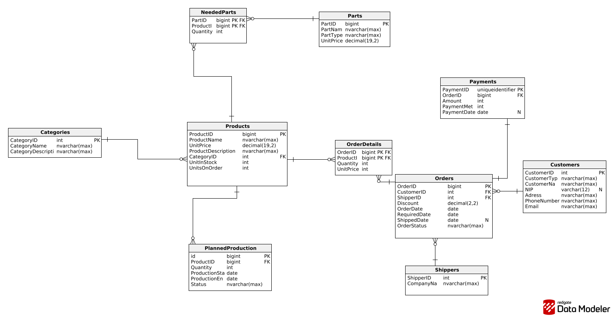

# Podstawy baz danych

dzień i godz zajęć: 16:45

nr zespołu: 1

**Autorzy:** Wiktor Jabrzyk, Jakub Kałużny, Karol Jabłoński

link do repozytorium git: [github.com/kubwik2/ProjektSql](https://github.com/kubwik2/ProjektSql)

---

# 1. Wymagania i funkcje systemu

# 2. Baza danych

## Schemat bazy danych



## Opis poszczególnych tabel

### 1. Categories

Tabela przechowująca kategorie mebli oraz wyposażenia (np. biurka gamingowe, fotele biurowe, stojaki na projektory).

- **Kod DDL:**

```sql
CREATE TABLE Categories (
    CategoryID int NOT NULL,
    CategoryName nvarchar(max) NOT NULL,
    CategoryDescription nvarchar(max) NOT NULL,
    CONSTRAINT Categories_pk PRIMARY KEY (CategoryID)
);
```

- **Opis atrybutów:**

| Nazwa atrybutu        | Typ danych      | Warunki integralności     | Opis / Znaczenie                   |
| :-------------------- | :-------------- | :------------------------ | :--------------------------------- |
| `CategoryID`          | `int`           | `PRIMARY KEY`, `NOT NULL` | Unikalny identyfikator kategorii   |
| `CategoryName`        | `nvarchar(max)` | `NOT NULL`                | Nazwa kategorii                    |
| `CategoryDescription` | `nvarchar(max)` | `NOT NULL`                | opis przeznaczenia danej kategorii |

---

### 2. Products

Główna tabela produktów oferowanych przez firmę. Przechowuje informacje o cenie, opisie oraz stanie w magazynie

- **Kod DDL:**

```sql
CREATE TABLE Products (
    ProductID bigint NOT NULL,
    ProductName nvarchar(max) NOT NULL,
    UnitPrice decimal(19,2) NOT NULL,
    ProductDescription nvarchar(max) NOT NULL,
    CategoryID int NOT NULL,
    UnitInStock int NOT NULL,
    UnitsOnOrder int NOT NULL,
    CONSTRAINT ProductID PRIMARY KEY (ProductID),
    CONSTRAINT Products_Categories FOREIGN KEY (CategoryID) REFERENCES Categories (CategoryID)
);
```

- **Opis atrybutów:**

| Nazwa atrybutu       | Typ danych      | Warunki integralności     | Opis / Znaczenie                                             |
| :------------------- | :-------------- | :------------------------ | :----------------------------------------------------------- |
| `ProductID`          | `bigint`        | `PRIMARY KEY`, `NOT NULL` | Unikalny identyfikator gotowego produktu                     |
| `ProductName`        | `nvarchar(max)` | `NOT NULL`                | Nazwa mebla/wyposażenia                                      |
| `UnitPrice`          | `decimal(19,2)` | `NOT NULL`                | Cena jednostkowa produktu                                    |
| `ProductDescription` | `nvarchar(max)` | `NOT NULL`                | opis techniczny                                              |
| `CategoryID`         | `int`           | `FOREIGN KEY`, `NOT NULL` | Odniesienie do kategorii z tabeli `Categories`               |
| `UnitInStock`        | `int`           | `NOT NULL`                | Bieżąca liczba sztuk dostępna w magazynie                    |
| `UnitsOnOrder`       | `int`           | `NOT NULL`                | Liczba sztuk produktu zarezerwowana w aktywnych zamówieniach |

---

### 3. Parts

Ewidencja części składowych, surowców i robocizny wykorzystywanych w procesie wytwarzania mebli.

- **Kod DDL:**

```sql
CREATE TABLE Parts (
    PartID bigint NOT NULL,
    PartName nvarchar(max) NOT NULL,
    PartType nvarchar(max) NOT NULL,
    UnitPrice decimal(19,2) NOT NULL,
    CONSTRAINT Parts_pk PRIMARY KEY (PartID)
);
```

- **Opis atrybutów:**

| Nazwa atrybutu | Typ danych      | Warunki integralności     | Opis / Znaczenie                                                  |
| :------------- | :-------------- | :------------------------ | :---------------------------------------------------------------- |
| `PartID`       | `bigint`        | `PRIMARY KEY`, `NOT NULL` | Unikalny identyfikator części                                     |
| `PartName`     | `nvarchar(max)` | `NOT NULL`                | Nazwa elementu                                                    |
| `PartType`     | `nvarchar(max)` | `NOT NULL`                | Rodzaj części                                                     |
| `UnitPrice`    | `decimal(19,2)` | `NOT NULL`                | Koszt jednostkowy zakupu części lub stawka za jednostke robocizny |

---

### 4. NeededParts

Określa ile jednostek danej części potrzeba do wyprodukowania jednej sztuki danego produktu.

- **Kod DDL:**

```sql
CREATE TABLE NeededParts (
    PartID bigint NOT NULL,
    ProductID bigint NOT NULL,
    Quantity int NOT NULL,
    CONSTRAINT NeededParts_pk PRIMARY KEY (ProductID, PartID),
    CONSTRAINT NeededParts_Parts FOREIGN KEY (PartID) REFERENCES Parts (PartID),
    CONSTRAINT Products_NeededParts FOREIGN KEY (ProductID) REFERENCES Products (ProductID)
);
```

- **Opis atrybutów:**

| Nazwa atrybutu | Typ danych | Warunki integralności                    | Opis / Znaczenie                                         |
| :------------- | :--------- | :--------------------------------------- | :------------------------------------------------------- |
| `ProductID`    | `bigint`   | `PRIMARY KEY`, `FOREIGN KEY`, `NOT NULL` | Identyfikator produktu gotowego `Products`               |
| `PartID`       | `bigint`   | `PRIMARY KEY`, `FOREIGN KEY`, `NOT NULL` | Identyfikator części składowej tabela `Parts`            |
| `Quantity`     | `int`      | `NOT NULL`                               | Liczba sztuk części wymagana do złożenia 1 szt. produktu |

---

### 5. Customers

Rejestr klientów sklepu – zarówno klientów indywidualnych, jak i firm.

- **Kod DDL:**

```sql
CREATE TABLE Customers (
    CustomerID int NOT NULL,
    CustomerType nvarchar(max) NOT NULL,
    CustomerName nvarchar(max) NOT NULL,
    NIP varchar(12) NULL,
    Adress nvarchar(max) NOT NULL,
    PhoneNumber nvarchar(max) NOT NULL,
    Email nvarchar(max) NOT NULL,
    CONSTRAINT Customers_pk PRIMARY KEY (CustomerID)
);
```

- **Opis atrybutów:**

| Nazwa atrybutu | Typ danych      | Warunki integralności     | Opis / Znaczenie                                              |
| :------------- | :-------------- | :------------------------ | :------------------------------------------------------------ |
| `CustomerID`   | `int`           | `PRIMARY KEY`, `NOT NULL` | Unikalny identyfikator klienta w systemie                     |
| `CustomerType` | `nvarchar(max)` | `NOT NULL`                | Typ klienta ("indywidualny", "firma")                         |
| `CustomerName` | `nvarchar(max)` | `NOT NULL`                | Imię i nazwisko klienta lub pełna nazwa firmy                 |
| `NIP`          | `varchar(12)`   | `NULL`                    | Numer NIP (wymagany dla firm, opcjonalny dla osób prywatnych) |
| `Adress`       | `nvarchar(max)` | `NOT NULL`                | Adres do wysyłki                                              |
| `PhoneNumber`  | `nvarchar(max)` | `NOT NULL`                | Numer telefonu kontaktowego                                   |
| `Email`        | `nvarchar(max)` | `NOT NULL`                | Adres e-mail do powiadomień i faktur                          |

---

### 6. Shippers

Lista przewoźników realizujących dostawy zamówionych mebli.

- **Kod DDL:**

```sql
CREATE TABLE Shippers (
    ShipperID int NOT NULL,
    CompanyName nvarchar(max) NOT NULL,
    CONSTRAINT Shippers_pk PRIMARY KEY (ShipperID)
);
```

- **Opis atrybutów:**

| Nazwa atrybutu | Typ danych      | Warunki integralności     | Opis / Znaczenie                   |
| :------------- | :-------------- | :------------------------ | :--------------------------------- |
| `ShipperID`    | `int`           | `PRIMARY KEY`, `NOT NULL` | Unikalny identyfikator przewoźnika |
| `CompanyName`  | `nvarchar(max)` | `NOT NULL`                | Nazwa przewoźnika                  |

---

### 7. Orders

Tabela zamówień złożonych przez klientów. Przechowuje kluczowe daty, status realizacji oraz przyznany rabat.

- **Kod DDL:**

```sql
CREATE TABLE Orders (
    OrderID bigint NOT NULL,
    CustomerID int NOT NULL,
    ShipperID int NOT NULL,
    Discount decimal(2,2) NOT NULL,
    OrderDate date NOT NULL,
    RequiredDate date NOT NULL,
    ShippedDate date NULL,
    OrderStatus nvarchar(max) NOT NULL,
    CONSTRAINT Orders_pk PRIMARY KEY (OrderID),
    CONSTRAINT Orders_Customers FOREIGN KEY (CustomerID) REFERENCES Customers (CustomerID),
    CONSTRAINT Shippers_Orders FOREIGN KEY (ShipperID) REFERENCES Shippers (ShipperID)
);
```

- **Opis atrybutów:**

| Nazwa atrybutu | Typ danych      | Warunki integralności     | Opis / Znaczenie                                                         |
| :------------- | :-------------- | :------------------------ | :----------------------------------------------------------------------- |
| `OrderID`      | `bigint`        | `PRIMARY KEY`, `NOT NULL` | Unikalny identyfikator zamówienia                                        |
| `CustomerID`   | `int`           | `FOREIGN KEY`, `NOT NULL` | Identyfikator klienta zamawiającego `Customers`                          |
| `ShipperID`    | `int`           | `FOREIGN KEY`, `NOT NULL` | Identyfikator wybranego przewoźnika `Shippers`                           |
| `Discount`     | `decimal(2,2)`  | `NOT NULL`                | Wartość rabatu                                                           |
| `OrderDate`    | `date`          | `NOT NULL`                | Data złożenia zamówienia                                                 |
| `RequiredDate` | `date`          | `NOT NULL`                | Termin realizacji oczekiwany przez klienta                               |
| `ShippedDate`  | `date`          | `NULL`                    | Rzeczywista data wysyłki zamówienia do klienta                           |
| `OrderStatus`  | `nvarchar(max)` | `NOT NULL`                | Status zamówienia (np. "Nowe", "W produkcji", "Wysłane", "Zrealizowane") |

---

### 8. OrderDetails

Tabela pozycji zamówień łącząca zamówienia z kupowanymi produktami.

- **Kod DDL:**

```sql
CREATE TABLE OrderDetails (
    OrderID bigint NOT NULL,
    ProductID bigint NOT NULL,
    Quantity int NOT NULL,
    UnitPrice int NOT NULL,
    CONSTRAINT OrderDetails_pk PRIMARY KEY (OrderID, ProductID),
    CONSTRAINT Orders_OrderDetails FOREIGN KEY (OrderID) REFERENCES Orders (OrderID),
    CONSTRAINT Products_OrderDetails FOREIGN KEY (ProductID) REFERENCES Products (ProductID)
);
```

- **Opis atrybutów:**

| Nazwa atrybutu | Typ danych | Warunki integralności                    | Opis / Znaczenie                                         |
| :------------- | :--------- | :--------------------------------------- | :------------------------------------------------------- |
| `OrderID`      | `bigint`   | `PRIMARY KEY`, `FOREIGN KEY`, `NOT NULL` | Identyfikator zamówienia `Orders`                        |
| `ProductID`    | `bigint`   | `PRIMARY KEY`, `FOREIGN KEY`, `NOT NULL` | Identyfikator produktu `Products`                        |
| `Quantity`     | `int`      | `NOT NULL`                               | Zamówiona liczba sztuk produktu                          |
| `UnitPrice`    | `int`      | `NOT NULL`                               | Cena jednostkowa produktu w chwili składania zamówienia. |

---

### 9. Payments

Ewidencja wpłat i płatności internetowych powiązanych z zamówieniami.

- **Kod DDL:**

```sql
CREATE TABLE Payments (
    PaymentID uniqueidentifier NOT NULL,
    OrderID bigint NOT NULL,
    Amount int NOT NULL,
    PaymentMethod int NOT NULL,
    PaymentDate date NULL,
    CONSTRAINT Payments_pk PRIMARY KEY (PaymentID),
    CONSTRAINT Orders_Payments FOREIGN KEY (OrderID) REFERENCES Orders (OrderID)
);
```

- **Opis atrybutów:**

| Nazwa atrybutu  | Typ danych         | Warunki integralności     | Opis / Znaczenie                             |
| :-------------- | :----------------- | :------------------------ | :------------------------------------------- |
| `PaymentID`     | `uniqueidentifier` | `PRIMARY KEY`, `NOT NULL` | Unikalny identyfikator płatności             |
| `OrderID`       | `bigint`           | `FOREIGN KEY`, `NOT NULL` | Identyfikator opłacanego zamówienia `Orders` |
| `Amount`        | `int`              | `NOT NULL`                | Zarejestrowana kwota transakcji              |
| `PaymentMethod` | `int`              | `NOT NULL`                | Kod metody płatności                         |
| `PaymentDate`   | `date`             | `NULL`                    | Data zaksięgowania płatności                 |

---

### 10. PlannedProduction

planowane i realizowanw zlecenia w przypadku braków w magazynie. Umożliwia harmonogramowanie pracy.

- **Kod DDL:**

```sql
CREATE TABLE PlannedProduction (
    id bigint NOT NULL,
    ProductID bigint NOT NULL,
    Quantity int NOT NULL,
    ProductionStart date NOT NULL,
    ProductionEnd date NOT NULL,
    Status nvarchar(max) NOT NULL,
    CONSTRAINT PlannedProduction_pk PRIMARY KEY (id),
    CONSTRAINT PlannedProduction_Products FOREIGN KEY (ProductID) REFERENCES Products (ProductID)
);
```

- **Opis atrybutów:**

| Nazwa atrybutu    | Typ danych      | Warunki integralności     | Opis / Znaczenie                                                |
| :---------------- | :-------------- | :------------------------ | :-------------------------------------------------------------- |
| `id`              | `bigint`        | `PRIMARY KEY`, `NOT NULL` | Unikalny identyfikator zlecenia                                 |
| `ProductID`       | `bigint`        | `FOREIGN KEY`, `NOT NULL` | Identyfikator produktu do wyprodukowania `Products`             |
| `Quantity`        | `int`           | `NOT NULL`                | Liczba sztuk zaplanowana do wyprodukowania.                     |
| `ProductionStart` | `date`          | `NOT NULL`                | Planowana data rozpoczęcia produkcji                            |
| `ProductionEnd`   | `date`          | `NOT NULL`                | Szacowana data ukończenia partii mebli                          |
| `Status`          | `nvarchar(max)` | `NOT NULL`                | Stan zlecenia (np. "Zaplanowane", "W realizacji", "Zakończone") |

# 3. Widoki, procedury/funkcje, triggery

## Widoki

## Procedury/funkcje

## Triggery
